# The display rulebook

<!-- Generated by `python -m tools.scene_replay rulebook --write` from tests/ui_next/rules/rules.toml and the tests beside it. Edit those, not this file. -->

Every rule the caption display applies, one entry each: what you see, when, where, a picture, what it conflicts with, what was said about it before, and a recommendation. Each rule is held by a named test that fails when the rule is broken on purpose. Mark each one keep, change or drop; a change is recorded in your words.

**So far:** 11 rules, 11 of them marked by you. The nine families follow, one at a time:

| Family | Rules written |
|---|---:|
| Wrapping and line breaks | 1 |
| Movement: what moves, falls, slides, glides or fades, and what waits | 4 |
| Ink: colours, word links, known words, highlights | 6 |
| Readings and underlines | 0 |
| The card stack and zones | 0 |
| What triggers a repaint, and pacing | 0 |
| Pointing: hover, what a point hits, selection | 0 |
| The transcript and the joined window | 0 |
| Video | 0 |

Order: rules that conflict with another come first, then rules that differ from one kind of window to another, then the rest.

## 1. A word link is one colour at both ends

**What you see.** With word links on, a linked word and its counterpart in the other row are
drawn in the same colour, each underlined in it.

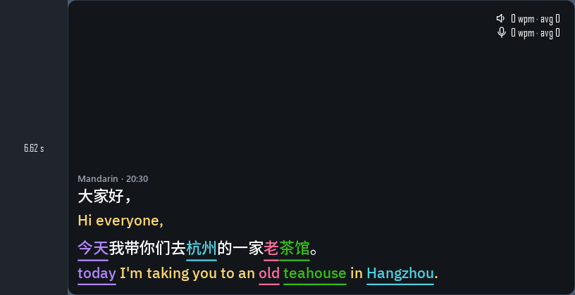

*A finished caption with four links: each linked word and its translation in one colour, underlined in it.*

**When.** Word links are on (Colours or Arrows), and a finished clause has links.

**Where.** In caption windows (Everyday, Conversation, Learning), Steady's transcript and live zone, Steady's card stack, the joined window, Video, Instant, Video, Scrolling. Not in the transcript window: no word links are drawn there: the transcript has no word-link setting.

**Conflicts with.**

- *Text still being spoken is fainter*: On a caption still being spoken, the underlines of its finished clauses are drawn as faint as text still being spoken. In Steady's card stack the words themselves are in full ink, so a linked word and its underline differ. In Video, a link under what was said can have no underline of its colour under the translation until the caption is finished. **Which wins:** Neither rule holds there. Seen in 2 of 54 card-stack runs and 3 of 108 Video runs, all on the long made-up stream; why Video's counterpart is missing is not yet found.

  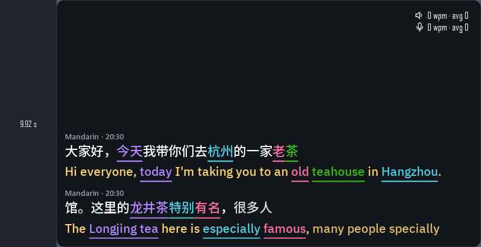

  *The card stack; the card at the foot is still being spoken. Under it the check finds an underline in the purple at the faintness of text still being spoken (#9b77dd) under a word that is not drawn that faint.*
- *What was said in its colour, the translation in its own*: A linked word is drawn in its link's colour, not its row's. **Which wins:** The link's colour wins on the linked words. The picture is under What was said in its colour.
- *unwritten: the transcript draws no word links (the transcript family)*: The transcript shows the same captions with no links. **Which wins:** Each window keeps its own way today. The picture is under What was said in its colour.

**What was said before.**

- The founder, 2026-11-16 ~23:55: "Ideally if you have a toggle option to colour pinyin, caption, translation as same colour as word link colour."
- The founder, 2026-11-17 08:18: "default this setting to be on, a first time user selecting the word linkage nav bar icon should see all coloured linked words / pinyin etc."
- The founder, 2026-11-25 ~22:12, on the transcript: "the same style as the real time captions. colors, word links".

**Recommendation.** Keep. Seven of the replay's 27 streams carry word links. It holds in every run of
them in the caption windows, the zones and the joined window, at both
widths, and in all but five runs in the card stack and Video (the conflict
below: a caption still being spoken, on the long made-up stream). A caption's links
take the colours in turn, numbered across the whole caption, so links side
by side differ; past eight links (the Classic look keeps eight of the ten
colours) they come round again. The transcript draws
no word links at all; you asked for them there, and that is planned. The
replay draws links as Colours: Arrows adds curves between the rows, which
it does not read.

**Your mark.** keep, 2026-11-28 - "marked by Claude under the founder's hand-off (2026-11-28 15:48)"

For engineers

- Rule id: `ink.a-link-is-one-colour`
- Decided in `ui_next/caption_marks.py::CaptionMarks._marks` (outside the paint) - a link's colour by its number, both rows alike
- Decided in `core/listening/display.py::numbered_links` (outside the paint) - links numbered in reading order across the whole caption
- Decided in `ui_next/caption_layout.py::_coloured_words` (outside the paint) - the linked words in their link's colour
- Decided in `ui_next/caption_layout.py::_underlines` (outside the paint) - the underline, below the descenders
- Shaped by: 151 and F14: underlines below the descenders; 340 (decision 0132): numbered across the whole caption, so no two links of a caption share a colour; 395 and 431: the linked words themselves in their link's colour, what was said and the translation each switched on its own
- Test: `tests/ui_next/rules/test_ink.py::test_a_link_is_one_colour_at_both_ends`
- Test: `tests/ui_next/rules/test_ink.py::test_a_link_is_one_colour_in_the_card_stack_while_spoken`
- Test: `tests/ui_next/rules/test_ink.py::test_the_transcript_draws_no_word_links`
- Planted break: `tests/ui_next/rules/test_ink.py::test_a_translation_linked_in_another_colour_is_seen`

## 2. Text still being spoken is fainter

**What you see.** A caption still being spoken is drawn fainter than a finished one. The
moment it is finished it is drawn in full ink.

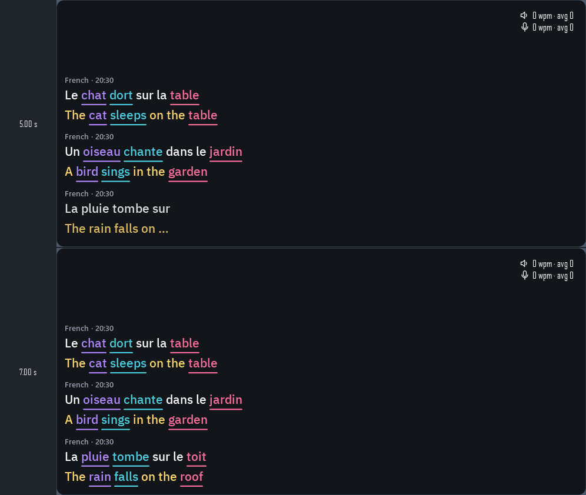

*The third caption is still being spoken (top): it is fainter than the two above it, and has no word links yet. Finished (bottom), it is in full ink and linked.*

**When.** A caption is still being spoken (a live caption), and then finishes.

**Where.** In caption windows (Everyday, Conversation, Learning), Steady's transcript and live zone, the joined window, Video, Instant, Video, Scrolling. Not in Steady's card stack: a caption still being spoken is drawn in full ink in the card stack.

**Conflicts with.**

- *unwritten: Steady's card stack draws a caption still being spoken in full ink (the card stack family)*: In the card stack, a caption still being spoken is in full ink, as a finished one is. **Which wins:** The card stack's way wins there, in 36 of its 54 runs in the ink replay.

  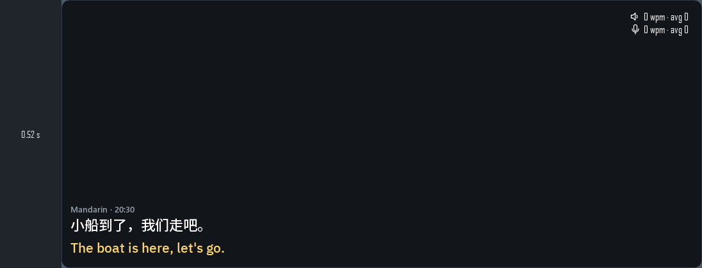

  *Steady's card stack: the caption at the foot is still being spoken, and is drawn in full ink.*

**What was said before.**

- The founder, 2026-11-20 ~19:45 (554's brief), on Steady's words ahead: "Default faint ahead, acquisition is preferable for me but probably default to both".

**Recommendation.** Keep. It holds on every caption window, the zones, the joined window and Video:
text still being spoken is drawn at 85 % of the way to its colour, and full
once finished. Steady's card stack is the exception: there a caption still
being spoken is drawn in full ink in 36 of its 54 runs. Why the stack
differs is for its own family to find; I would keep this rule for the other windows, and
rule on the stack when that family is written.

**Your mark.** keep, 2026-11-28 - "marked by Claude under the founder's hand-off (2026-11-28 15:48)"

For engineers

- Rule id: `ink.fainter-while-spoken`
- Decided in `ui_next/caption_window.py::unfinished_ink` (outside the paint) - how faint, by the Lab's choice for text still being spoken (85 % by default)
- Decided in `ui_next/caption_layout.py::_line_alpha` (outside the paint) - a live line at the live share, Quick preview's at its own
- Decided in `ui_next/caption_layout.py::CaptionLayout.paint` (inside the paint) - the words already settled keep their final ink
- Decided in `ui_next/caption_window.py::Canvas._paint_panel` (inside the paint) - Steady's words ahead drawn at half ink
- Shaped by: 284: the Lab's choice of how text still being spoken looks; 494 (decision 0228): words already settled keep their final ink; 554 (desktop #969): Steady's words ahead faint by default
- Test: `tests/ui_next/rules/test_ink.py::test_text_still_being_spoken_is_fainter`
- Planted break: `tests/ui_next/rules/test_ink.py::test_a_live_caption_in_full_ink_is_seen`

## 3. The newest caption brightest, older ones a step back

**What you see.** The newest caption is drawn in full ink. Each caption before it keeps a
little less of its contrast, a step at a time, down to 85 % of it five
captions back. A caption stays in full ink for its first 3 seconds.

*Three finished captions: the newest (bottom) in white; the one above it #fcfcfc, the first #f8f8f9.*

**When.** A new caption arrives, and the ones before it move back a place.

**Where.** In caption windows (Everyday, Conversation, Learning), Steady's card stack, the joined window. Not in Steady's transcript and live zone: every caption in Steady's live zone keeps full ink. Not in Video, Instant: every subtitle keeps full ink. Not in Video, Scrolling: every subtitle keeps full ink. Not in the transcript window: every line is in the interface's colours; none is the newest.

**Conflicts with.**

- *unwritten: Steady's live zone and Video keep every caption in full ink (the card stack and Video families)*: In Steady's live zone and in Video no caption steps back. **Which wins:** Each keeps its own way; the step back is only in the caption windows, the card stack and the joined window.

**What was said before.**

- The founder, 2026-11-08 ~20:20 (242's FEEDBACK-2026-11-08.md, F21): "I feel like new lines show fade in slightly or old lines fade out slowly. Not actually fade in and fade out but visibly obvious from a subtle contrast different. this way you can see what a new line is and what an old line is"
- The founder, 2026-11-13 (305): "Lab option for gradual text colour change".

**Recommendation.** Change. It holds in every run of a caption window, the card stack and the joined
window, but the step is too small to see on the Classic look: the caption
before the newest is #fcfcfc against the newest's #ffffff, and the one
before that #f8f8f9 (the picture). You asked for a difference that is
subtle but visibly obvious. I would make the first step the visible one:
the caption before the newest at once at the contrast it reaches five
captions back today, the older ones staying there. Steady's live zone and
Video keep every caption in full ink, and the transcript has no newest.

Marked change on 2026-11-28 by Claude under the founder's hand-off
(2026-11-28 15:48): the step must be visible on every theme (your
"visibly obvious", 2026-11-08) and must stay light (805: older captions
stay readable, a light fade, not a dark one). The look change itself is a
later display unit, and you see it in a preview before it ships.

**Your mark.** change, 2026-11-28 - "marked by Claude under the founder's hand-off (2026-11-28 15:48)"

For engineers

- Rule id: `ink.older-captions-step-back`
- Decided in `ui_next/caption_window.py::Canvas._paint_panel` (inside the paint) - works out each caption's step back as it draws it
- Decided in `ui_next/views/arrivals.py::older_alphas` (outside the paint) - how much contrast older captions keep: 85 %; none taken with Windows' high contrast or while you have scrolled back
- Decided in `ui_next/views/lab.py::by_place` (outside the paint) - a step for each place back, over five captions (three in Steady)
- Decided in `ui_next/views/lab.py::newness` (outside the paint) - new for 3 seconds
- Shaped by: 249 and 253 (F21): the newest line brighter, older lines a step back; 305: step by step rather than all at once; 584: the contrast kept, not the paint's opacity
- Test: `tests/ui_next/rules/test_ink.py::test_a_caption_is_new_for_the_time_the_rulebook_allows`
- Test: `tests/ui_next/rules/test_ink.py::test_older_captions_step_back`
- Planted break: `tests/ui_next/rules/test_ink.py::test_older_captions_as_bright_as_the_newest_are_seen`

## 4. What was said in its colour, the translation in its own

**What you see.** What was said is drawn in the look's text colour and its translation in the
look's translation colour: white and gold on the Classic look. Every row
keeps its kind's colour, whatever the window.

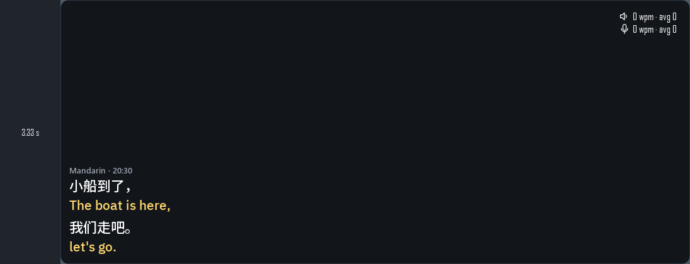

*A finished caption in the default window: what was said in white, its translation in gold.*

**When.** Always: every caption, still being spoken or finished.

**Where.** In caption windows (Everyday, Conversation, Learning), Steady's transcript and live zone, Steady's card stack, the joined window, Video, Instant, Video, Scrolling. Not in the transcript window: what was said is the interface's text colour and the translation the interface's grey, not the gold.

**Conflicts with.**

- *A word link is one colour at both ends*: With word links on, a linked word is drawn in its link's colour, not its row's. **Which wins:** The link's colour wins on the linked words (Colour linked words is on for both rows by default); the rest of the row keeps its own.

  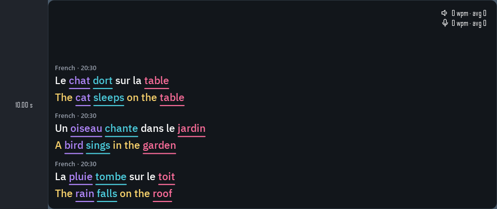

  *Word links on: each linked word in its link's colour at both ends; the other words in white and gold.*
- *unwritten: the transcript draws in the interface's colours (the transcript family)*: The same captions in the transcript window: what was said in the interface's text colour, the translation in its grey, and no word links. **Which wins:** Each window keeps its own colours today; they do not meet on one screen.

  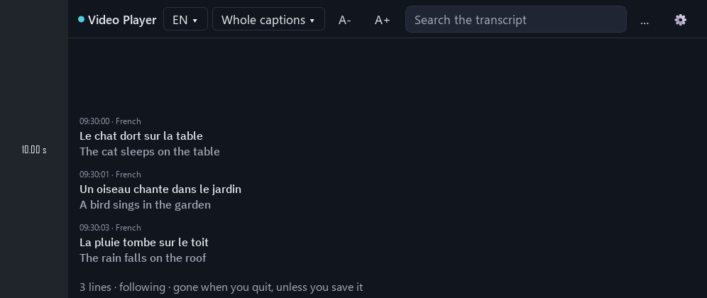

  *The transcript with the same three captions: no gold, and no word links.*

**What was said before.**

- The founder, 2026-11-25 ~22:12: "can the transcript have the same style as the real time captions. colors, word links, try to achieve relative feature parity with transcript too."

**Recommendation.** Keep. It holds on every caption window, the card stack, the zones, the joined
window and Video (all 324 of their runs in the ink replay). The transcript is
the one place it does not: its translation is the interface's grey. You asked
for the transcript to take the live captions' colours, and that is already
planned (the transcript family); I would keep this rule and let the
transcript join it then.

**Your mark.** keep, 2026-11-28 - "marked by Claude under the founder's hand-off (2026-11-28 15:48)"

For engineers

- Rule id: `ink.own-colours`
- Decided in `ui_next/caption_window.py::look_ink` (outside the paint) - the window's ink from the look: its two colours, at the look's contrast and vibrance
- Decided in `ui_next/caption_window.py::toned` (outside the paint) - the colours moved to the contrast and vibrance sliders
- Decided in `ui_next/caption_layout.py::CaptionLayout.paint` (inside the paint) - picks each row's colour by its kind as it draws it
- Decided in `ui_next/transcript_window.py::TranscriptList._paint` (inside the paint) - the transcript's own ink: the interface's text and grey
- Shaped by: the proof of concept's overlay: "white is what was said, yellow is always a translation" (`caption_layout.Ink`); 481: the contrast and vibrance sliders
- Test: `tests/ui_next/rules/test_ink.py::test_the_replays_colours_are_the_looks_own`
- Test: `tests/ui_next/rules/test_ink.py::test_each_row_is_in_its_own_colour`
- Test: `tests/ui_next/rules/test_ink.py::test_the_transcript_is_where_rows_take_the_interfaces_colours`
- Planted break: `tests/ui_next/rules/test_ink.py::test_swapped_colours_are_seen`

## 5. A new row waits, then fades in where it stays

**What you see.** Every new row, whatever brings it, never appears on top of other text: a
caption carrying on to another line, or a caption's next part. If its place
is still taken, it waits until the text there has moved away, then fades in
where it will stay; if its place is free, it shows at once. A translation
never shows before its own text.

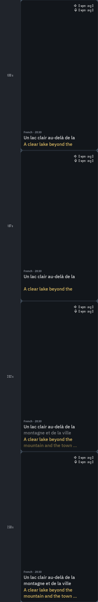

*A caption carries on to a second line. Its first row and its translation move apart first (second frame); only then does the new row fade in, in the place where it stays (third and fourth frames). In this replay the new words are not seen for 0.95 s after they arrive.*

**When.** A caption carries on to a second line (a narrow window, Long lines: Grouped);
a live caption finishes as more than one part; a revision carries words onto
a new line.

**Where.** In caption windows (Everyday, Conversation, Learning), the joined window.

**Conflicts with.**

- *Words never fall*: On the made-up stream of rapid revisions, a row held low so that its words do not fall still lies where a new caption, or words moved to another row, come in; in narrow windows a new row can also start to fade in and then move. **Which wins:** Words never fall wins: two texts touch for a few frames. Seen in 8 of 216 caption-window replays and 8 of 216 joined-window replays, all on that one stream; none on the recorded captions.

  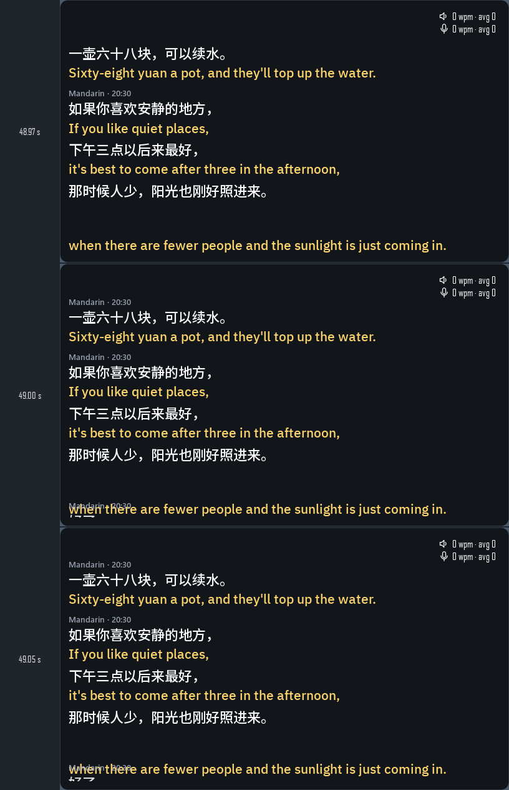

  *The made-up stream of rapid revisions: a new caption slides in (middle frame) while the row above it is still held low, and the two touch until that row has moved up (bottom).*

**What was said before.**

- The founder, 2026-11-25 ~17:35 (959's brief): "for multi line captions (grouped), the 2nd lines will slide in and overlap with existing text".
- The founder, 2026-11-25 ~22:07 (969's brief): "See if you can polish narrow width overflow second line slide in also (this overlaps text briefly and feels unpolished)."

**Recommendation.** Keep. It now holds for every new row in the captions you see: a second line in a
narrow window, and a live caption that finishes as two parts in the ordinary
wide window, where the second part used to be drawn over the first for about
a fifth of a second. A new row whose place is already free still shows at
once. What is left is on a made-up stream of rapid revisions (below).

**Your mark.** change, 2026-11-27 - "Yes sounds good with display rules"

For engineers

- Rule id: `movement.a-new-row-waits-then-fades-in`
- Decided in `ui_next/caption_window.py::Canvas._reveal_wraps` (inside the paint) - holds the new row back while anything is in its place or still to pass through it, and a translation while its text is held; then fades it in
- Decided in `ui_next/caption_window.py::CaptionWindow._note_arrivals` (outside the paint) - marks which new rows wait: a carried-on line in Grouped, and any new row that would not rise into place (a new part, words carried to a new line)
- Shaped by: desktop #1237 (969, commit 5c853b3d9); 959 (reverted): the same moment, tried as a slide from the right; 984: every new row that appears where it stays waits for its place
- Test: `tests/ui_next/rules/test_movement.py::test_a_second_line_waits_then_fades_in_where_it_stays`
- Test: `tests/ui_next/rules/test_movement.py::test_a_captions_second_part_waits_too`
- Test: `tests/ui_next/rules/test_movement.py::test_a_new_part_waits_in_every_arrangement`
- Planted break: `tests/ui_next/rules/test_movement.py::test_a_second_line_drawn_at_once_is_seen`
- Planted break: `tests/ui_next/rules/test_movement.py::test_a_second_part_drawn_at_once_is_seen`

## 6. No sideways slide

**What you see.** Text never slides in from the side. A new row appears in its own place, and
rows already on screen do not travel left or right.

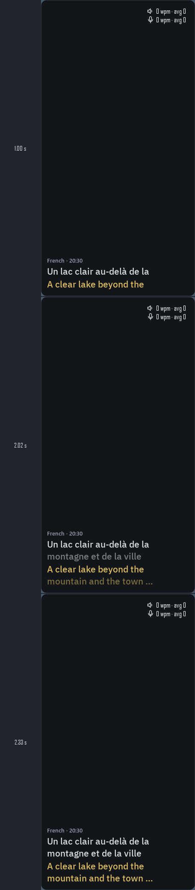

*A caption carries on to a second line: the new row comes in at the left edge, in its own place, with no travel across the window.*

**When.** A caption gains a row, or a new caption arrives.

**Where.** In caption windows (Everyday, Conversation, Learning), Steady's transcript and live zone, Steady's card stack, the joined window, Video, Instant, the transcript window. Not in Video, Scrolling: a row longer than the window pans sideways there, by design (686's agreed Video simulation).

**Conflicts with.**

- *unwritten: Video Scrolling pans a long row (the Video family)*: In Video Scrolling a row too long for the window moves sideways so its end can be read. **Which wins:** Video Scrolling's pan, in that mode only; it was agreed in 686's simulation.

**What was said before.**

- The founder, 2026-11-25 ~18:20, after trying preview 8g: "can you revert this slide right changes. It is so bad".

**Recommendation.** Keep. You tried the alternative and rejected it. The rule holds in all 1,188
replays outside Video Scrolling.

**Your mark.** keep, 2026-11-27 - "Yes sounds good with display rules"

For engineers

- Rule id: `movement.no-sideways-slide`
- Decided in `ui_next/caption_window.py::Canvas._paint_panel` (inside the paint) - every row is drawn from the same left edge; nothing moves a row sideways
- Shaped by: 959 (commit 14007500b): a new row slid in from the right, like a wedge; the revert (commit 5fd0c545a), 2026-11-25 ~18:20, at the founder's word
- Test: `tests/ui_next/rules/test_movement.py::test_no_row_slides_sideways`
- Test: `tests/ui_next/rules/test_movement.py::test_video_scrolling_is_where_a_row_does_pan`
- Planted break: `tests/ui_next/rules/test_movement.py::test_a_row_sliding_in_from_the_right_is_seen`

## 7. The approved glide

**What you see.** When captions move up to make room, they glide. They never move faster than
300 px a second, and never jump (more than 6 px in a single frame). A change
that comes while they are gliding joins the same glide.

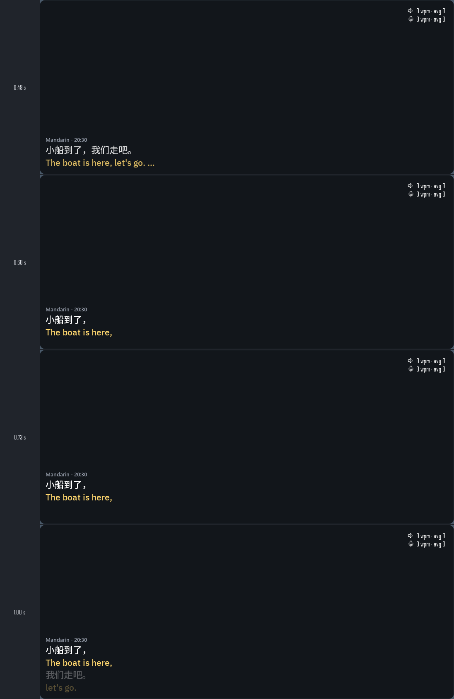

*A caption finishes as two parts: the first part glides up to make room, a few pixels a frame, until it rests.*

**When.** A new caption arrives, or a caption on screen gains a row.

**Where.** In caption windows (Everyday, Conversation, Learning), the joined window. Not in Steady's transcript and live zone: a caption moving from the live zone to the transcript above steps into place. Not in Steady's card stack: the card stack turns and steps in its own way. Not in Video, Instant: subtitles lift in their own steps. Not in Video, Scrolling: subtitles lift in their own steps. Not in the transcript window: the transcript does not glide: a new line moves the page in one step.

**Conflicts with.**

- *Words never fall*: In a narrow window, when a revision moves a word to the next row, that row is put in a new place in a single frame: a jump of 28 to 84 px. The picture is under Words never fall. **Which wins:** Words never fall wins: the row jumps instead of gliding.
- *unwritten: too much at once is put in place at once (the movement family)*: When more arrives together than the window is tall, the captions are put in their places in one frame instead of gliding. **Which wins:** The burst wins: no glide. Seen only on the made-up stream that sends a burst.

**What was said before.**

- 827's SPEC, rule 6: "One motion rule. The stack only grows, by whole pairs. Every growth, whatever its cause, is one glide ... never faster than 300 px/s, keeping its speed when another change comes mid-glide."
- 346's thresholds, kept by 827's replay: a jump is more than 6 px in a frame at more than 360 px a second.

**Recommendation.** Keep. It holds in 427 of 432 replays of a caption window and the joined window;
the five that jump are narrow windows where a word moves to another row (the
conflict with Words never fall). Steady's zones and cards, Video and the
transcript each move in their own way today (see Where); whether they should
share this glide is yours to rule on when those families are written.

**Your mark.** keep, 2026-11-27 - "Yes sounds good with display rules"

For engineers

- Rule id: `movement.the-approved-glide`
- Decided in `ui_next/views/cards.py::Glide.push` (outside the paint) - the spring, and its top speed
- Decided in `ui_next/caption_window.py::CaptionWindow._note_arrivals` (outside the paint) - turns a change in the rows into a glide
- Decided in `ui_next/caption_window.py::Canvas._list_positions` (inside the paint) - reads how far the glide has got on every paint
- Decided in `ui_next/caption_window.py::CaptionWindow._settle_burst` (outside the paint) - more than the window's height at once: put in place with no glide
- Shaped by: 552 and 583: the card stack's glide and its top speed; 830: the glide for every growth of the stack, and the motion replay; desktop #1237 (969)
- Test: `tests/ui_next/rules/test_movement.py::test_the_glides_top_speed_is_the_one_the_rulebook_states`
- Test: `tests/ui_next/rules/test_movement.py::test_rows_glide_and_never_jump`
- Test: `tests/ui_next/rules/test_movement.py::test_rows_glide_when_a_word_moves_to_the_next_row`
- Planted break: `tests/ui_next/rules/test_movement.py::test_the_old_step_is_seen_as_a_jump`

## 8. Words never fall

**What you see.** Text that is on screen never moves down. When unsure text is revised to
something shorter, or taken away, the space it held stays as a gap. New text
fills the gap first; otherwise everything moves up to make room. The gap
closes only when more text arrives, or when you scroll, resize the window or
change the text size.

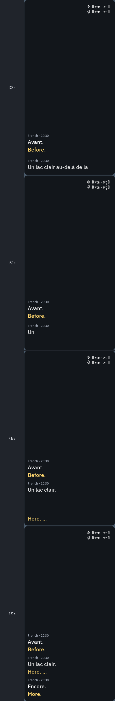

*A long live caption is arriving (top) when it is revised to one word. The word stays where it was, and the space under it is left as a gap with the translation still below it (second and third frames). When the next caption arrives, the translation moves up to close the gap (bottom). Nothing moved down.*

**When.** A live caption is revised to fewer words; a draft caption is replaced by a
shorter finished one; a caption is withdrawn; a translation is revised
shorter or arrives late; readings appear or go; two captions are joined or
one is split.

**Where.** In caption windows (Everyday, Conversation, Learning), Steady's transcript and live zone, Steady's card stack, the joined window, Video, Instant, Video, Scrolling, the transcript window.

**Conflicts with.**

- *unwritten: a live caption's line breaks follow its newest text (the wrapping family)*: A live caption is revised and a word that ended the first row now starts the second. The word may not fall, so the whole second row is put where the word was: it is drawn over the first row, and its own place is left empty. **Which wins:** Words never fall wins, and two rows are drawn over each other until the next change (0.6 s in the replay). A row is pulled to a new place like this in 5 of 432 caption-window and joined-window replays, all in a narrow window, 4 of them with Long lines: Display new lines. In 0.1.12, before the fix, the word fell 66 px instead.

  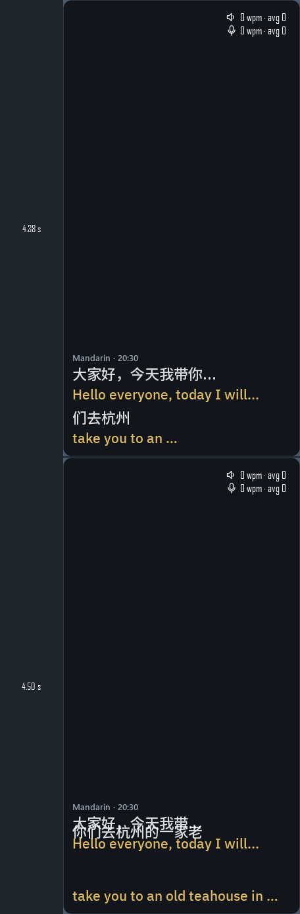

  *A narrow window, Long lines: Display new lines. After a revision (bottom) the second row of the caption is drawn over the first, and the place under it is empty.*
- *unwritten: Video breaks its two lines again from the newest text (the Video family)*: In Video, when a subtitle on two lines is revised, its lines are broken again from the new text. A word can move from the end of the first line to the start of the second, and the second line can start lower than it was: text falls by a line's height or by about 18 px. **Which wins:** Today Video's line break wins and the words fall. Seen in 10 of 432 Video replays, all on the long made-up stream.

  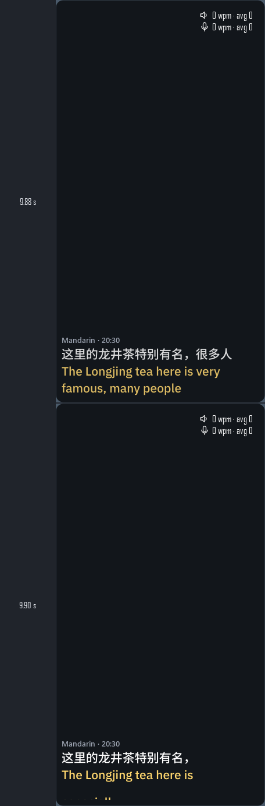

  *Video, one frame apart: the translation's second line is 18 px lower in the second frame.*

**What was said before.**

- The founder, 2026-11-25 ~22:07 (969's brief): "Words never fall - hard rule, this occurs when text renders but is unsure / unestablished captions / translations, leave that gap there and allow new content to fill it / push it up. Cover all edge cases."
- 827's SPEC, rule 5 (frozen breaks): "Once a pair is closed and shown, the place where each of its rows ends never moves. A correction changes words in place." Written, not applied: the windows do not pass the frozen breaks.

**Recommendation.** Keep. It is your hard rule and it holds on every caption window, the card stack,
the zones, the joined window and the transcript in all 972 replays of those.
Two things need your eye. The fix that made it hold (969) pulls a row up
over the row above when a word moves to the next line, in a narrow window,
mostly with Long lines set to Display new lines (first conflict). And it does not
yet hold in Video (second conflict). I would keep the rule, and settle the
first conflict by not moving a word that is already shown to another line.

**Your mark.** keep, 2026-11-27 - "Yes sounds good with display rules"

For engineers

- Rule id: `movement.words-never-fall`
- Decided in `ui_next/views/row_positions.py::row_tops` (outside the paint) - fits new rows into the gap; a kept row never gets a lower top
- Decided in `ui_next/caption_window.py::Canvas._place_rows` (inside the paint) - applies it to the page on every paint; remembers the last tops on the canvas
- Decided in `ui_next/caption_window.py::Canvas._follow_words` (inside the paint) - carries a surviving word's bound across a new line break
- Decided in `ui_next/video.py::VideoFlow.advance` (outside the paint) - Video's own placing, which does not go through row_tops
- Shaped by: desktop #1237 (969, commit 5c853b3d9): the rule, in six new fields on the canvas; 809 (commit 5b38f1efe): room for the translation from the first slide-in; DECISIONS #230: lines only grow
- Test: `tests/ui_next/rules/test_movement.py::test_words_never_fall`
- Test: `tests/ui_next/rules/test_movement.py::test_words_never_fall_in_video_when_a_subtitle_is_revised`
- Planted break: `tests/ui_next/rules/test_movement.py::test_a_one_frame_fall_is_seen`

## 9. Every row is a single line

**What you see.** Each row of a caption is one line of text. A caption too long for the window
carries on in a new row of its own, under the first. A row is never wrapped
inside itself.

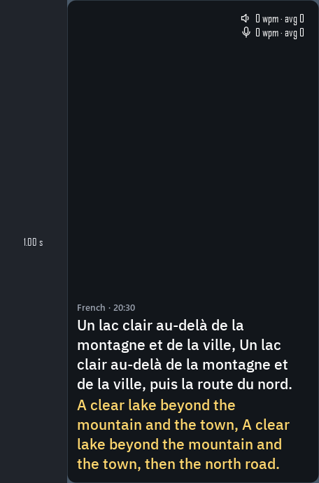

*A caption far wider than a narrow window: it carries on in new rows, each one line, with its translation's rows under them.*

**When.** A caption, or its translation, is wider than the window's room for text.

**Where.** In caption windows (Everyday, Conversation, Learning), Steady's transcript and live zone, Steady's card stack, the joined window, Video, Instant, Video, Scrolling. Not in the transcript window: a long row wraps inside itself there, on the older layout.

**Conflicts with.**

- *unwritten: the transcript wraps a long row inside itself (the transcript family)*: The same caption in the transcript window is one row that wraps. **Which wins:** Each window keeps its own way today; they do not meet on one screen.

  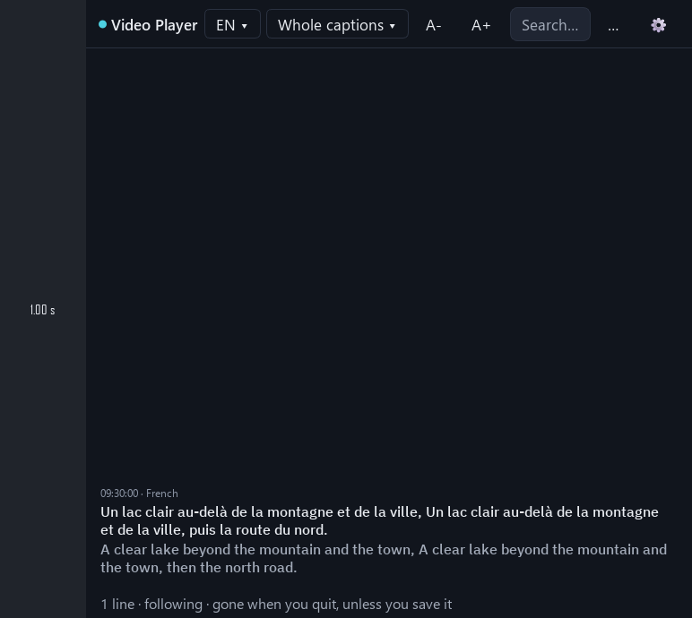

  *The same caption in the transcript: one row, wrapped inside itself.*

**What was said before.**

- 827's SPEC, rule 4: "Overflow, never wrap. A row that is full ends with ... The text carries on at the start of the next pair, and that pair slides in. A row is never wrapped inside itself."
- The founder, 2026-11-25 22:12, on the transcript: it should have "the same style as the real time captions".

**Recommendation.** Keep. It holds in every caption window and in Video (1,296 replays). The transcript
is the one place that still wraps a long row inside itself; moving it to the
live style is already planned, and that would make this one rule everywhere.

**Your mark.** keep, 2026-11-27 - "Yes sounds good with display rules"

For engineers

- Rule id: `wrapping.every-row-is-a-single-line`
- Decided in `ui_next/caption_layout.py::_single_line_rows` (outside the paint) - cuts a composed row into one item per line
- Decided in `ui_next/caption_layout.py::CaptionLayout._flowed` (outside the paint) - the composer's rows, for every caption window
- Decided in `ui_next/caption_layout.py::CaptionLayout._lay_out` (outside the paint) - which layout path a line takes; Video asks for one line a row
- Decided in `ui_next/caption_layout.py::_laid_text` (outside the paint) - the transcript's rows: Qt wraps them inside the row
- Shaped by: 832 (commit 75b0de437): no line wraps; long translations become new rows; 340 (decision 0132): the one layout, the composer
- Test: `tests/ui_next/rules/test_wrapping.py::test_every_row_is_a_single_line`
- Test: `tests/ui_next/rules/test_wrapping.py::test_a_long_caption_carries_on_in_rows_of_its_own`
- Test: `tests/ui_next/rules/test_wrapping.py::test_the_transcript_is_where_a_row_does_wrap`
- Planted break: `tests/ui_next/rules/test_wrapping.py::test_a_row_left_wrapped_is_seen`

## 10. A link's colour never looks like the text's

**What you see.** No word link is drawn in a colour that looks like its rows' own text. A link
colour too near the text colour or the translation colour is skipped, and
the next takes its turn: on the Classic look the orange is skipped, beside
the gold translation.

*The Classic look: the first link is purple, not the orange that would read like the gold translation.*

**When.** Word links are on; the look's colours decide which link colours are kept.

**Where.** In caption windows (Everyday, Conversation, Learning), Steady's transcript and live zone, Steady's card stack, the joined window, Video, Instant, Video, Scrolling.

**Conflicts with.** None found among the rules written so far.

**What was said before.**

- The founder, 2026-11-17 (446's brief): "orange colour linkage is not that distinguishable from the brown one especially the word colouring."
- The founder, 2026-11-20 ~19:45 (554's brief): "issue with word linkage matching font colours at times, need to make the font colours slightly more dynamic to not take same or similar colours to font colour".

**Recommendation.** Keep. You asked for it, and it holds in every run of the seven streams that carry
word links. It is checked on the Classic look only: the replay does not yet
try the other looks.

**Your mark.** keep, 2026-11-28 - "marked by Claude under the founder's hand-off (2026-11-28 15:48)"

For engineers

- Rule id: `ink.links-clear-of-the-text`
- Decided in `ui_next/caption_marks.py::_link_colours` (outside the paint) - drops each colour less than 22 apart (CIEDE2000) from either row's colour
- Shaped by: 446: three colours changed so every two read apart; 554 (desktop #983): link colours at least 22 CIEDE2000 from the text
- Test: `tests/ui_next/rules/test_ink.py::test_the_distance_kept_from_the_text_is_the_one_the_rulebook_states`
- Test: `tests/ui_next/rules/test_ink.py::test_no_link_reads_like_its_rows_text`
- Planted break: `tests/ui_next/rules/test_ink.py::test_the_orange_beside_the_gold_is_seen`

## 11. No word links on words still being spoken

**What you see.** The clause still being spoken has no word links. Its links come when it is
finished, or when the next clause begins; clauses of the same caption that
are already finished keep theirs.

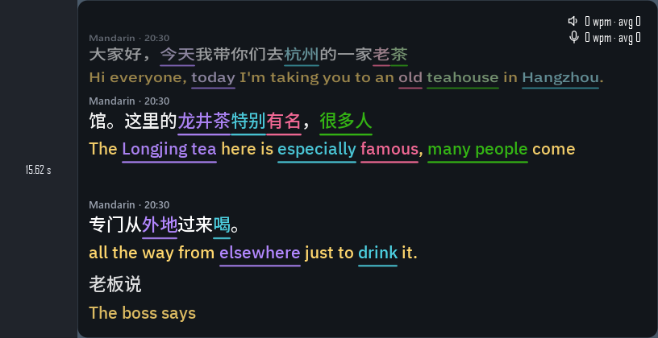

*The card at the foot is still being spoken: its finished clause is linked, the clause still being spoken (the last row pair) is not.*

**When.** Word links are on and a caption is still being spoken.

**Where.** In caption windows (Everyday, Conversation, Learning), Steady's transcript and live zone, Steady's card stack, the joined window, Video, Instant, Video, Scrolling.

**Conflicts with.** None found among the rules written so far.

**What was said before.**

- The proof of concept's design, kept in `core/listening/display.py`: "Word links are drawn only on settled clauses, never on a live caption's last (its words are still changing)."

**Recommendation.** Keep. It holds in every run of the seven streams that carry word links. Links
that came and went as the words changed would flicker; the finished clauses of a caption still being
spoken keep theirs, so a long caption is not bare while it lasts.

**Your mark.** keep, 2026-11-28 - "marked by Claude under the founder's hand-off (2026-11-28 15:48)"

For engineers

- Rule id: `ink.no-links-while-spoken`
- Decided in `core/listening/display.py::caption_rows` (outside the paint) - links only on settled clauses: never the last clause of a live caption
- Shaped by: the proof of concept's word links (docs/word-links.md): "never on a live caption's last (its words are still changing)"
- Test: `tests/ui_next/rules/test_ink.py::test_a_caption_still_being_spoken_has_no_links`
- Planted break: `tests/ui_next/rules/test_ink.py::test_a_live_caption_linked_is_seen`

